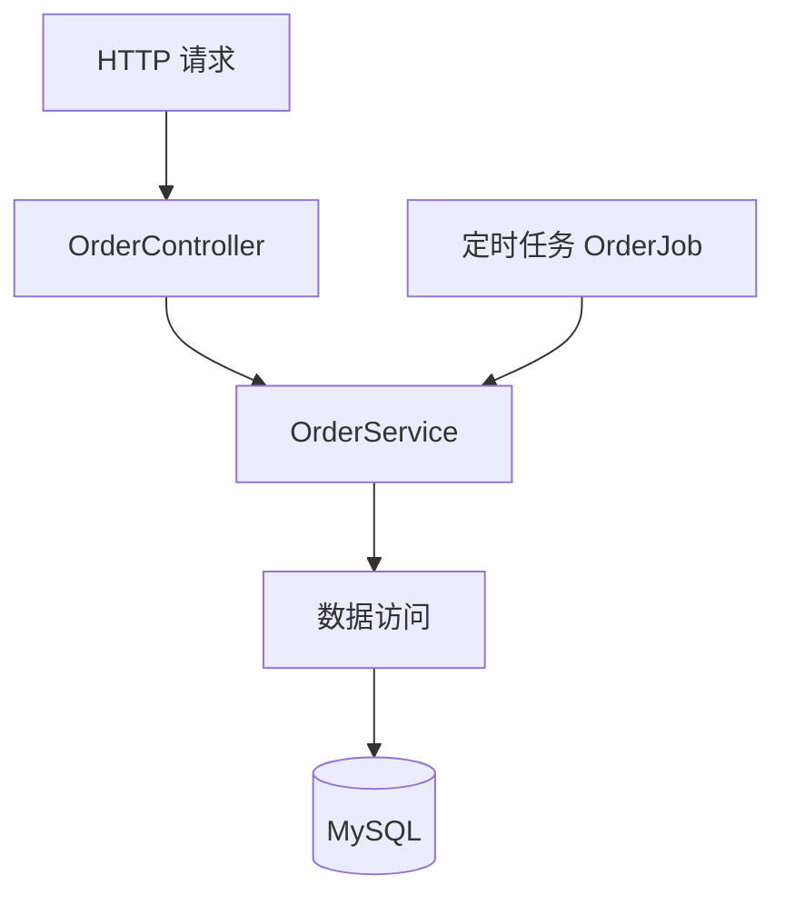

# 分层职责与校验

所属章节：[[00-第一章-项目结构与职责]]。按章节导读的顺序阅读，也可以作为复习专题。

## 分层解决什么问题

分层让不同原因引起的变化有明确归属，同时便于复用业务能力。

- 请求字段变化，主要影响接口输入和接收方式。
- 满减规则变化，主要影响业务逻辑。
- SQL 优化，主要影响数据访问。

HTTP 下单和定时任务创建订单可以共同调用 OrderService。如果下单规则全部写在 Controller，其他入口就难以直接复用。



判断提示：换成任务、消息消费等入口后仍然需要遵守的规则，通常属于业务层。这是辅助判断方式，不是绝对公式。
## 各层职责

| 部分 | 主要职责 | 订单示例 |
| --- | --- | --- |
| Controller | 接收 HTTP 参数、触发校验、获取认证身份、调用业务入口、返回响应 | 接收商品 ID 和数量 |
| Service | 执行业务规则、编排流程、协调模块与事务 | 检查商品、计算金额、创建订单 |
| Mapper / Repository | 数据库查询、新增、修改、删除 | 查询商品、插入订单 |
| Entity / PO | 表达持久化数据结构 | 订单 ID、金额、状态等 |
| DTO | 请求、响应或模块间的数据传输 | 创建订单请求、订单详情响应 |
| Config | 框架和基础设施配置 | Redis 连接配置 |

Mapper 常见于 MyBatis；Repository 是另一种数据访问抽象名称，不必同时建立两层。

Controller 可以从认证上下文获取当前用户 ID，Service 判断该用户是否允许执行具体业务。不能仅相信客户端提交的买家 ID。
## 输入校验与业务校验

| 判断 | 归属 | 原因 |
| --- | --- | --- |
| 数量不能为空、必须大于 0 | 请求 DTO 声明，Controller 触发 | 仅凭请求即可判断 |
| 商品存在且可售 | 商品业务入口 | 依赖系统状态和业务规则 |
| 数量不超过库存 | 业务层协调，数据层保障并发正确性 | 查询后库存还可能变化 |
| 每人每天限购两件 | 业务层 | 需要购买记录和规则 |

请求校验示意，省略 import、访问器等：

```java
public class CreateOrderRequest {
    @NotNull(message = "商品不能为空")
    private Long productId;

    @NotNull(message = "数量不能为空")
    @Min(value = 1, message = "数量必须大于零")
    private Integer quantity;
}
```

需要校验依赖及 Controller 上的触发方式，例如 `@Valid @RequestBody`。只给 DTO 写注解，并不意味着所有 Java 调用都会自动校验。

内部任务调用 Service 时不会天然经过 HTTP 校验。业务入口需要明确输入前提，保护关键业务不变量。

### 失败如何返回

Service 通过业务异常表达“商品不存在”“商品已下架”等失败；统一异常处理转换为接口约定的 HTTP 状态和响应体；前端决定提示方式。Service 不需要构造 HTTP 响应或决定弹窗。
