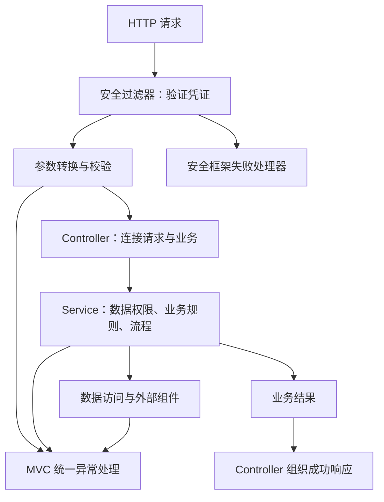

# 第二章：接口设计与数据流转

> 第一章回答“代码放在哪里、谁负责什么”，本章回答“一次请求如何在这些职责之间流转”。以下接口、状态码和命名是当前学习约定，不是所有项目的唯一标准。

前置：[[00-第一章-项目结构与职责|第一章-项目结构与职责]] · 路线：[[Spring Boot工程实践学习路线]]

## 1. 接口表达业务意图

接口不只是把数据库的增删改查开放出去。例如取消订单可能涉及权限、状态判断、库存返还、退款，不能等同于允许调用方任意修改 status。

创建订单以 `POST /orders` 为例：用户表达“购买什么、买多少”，后端负责判断是否允许并产生交易结果。

## 2. 谁决定请求中的数据

```json
{
  "productId": 1001,
  "quantity": 2
}
```

| 信息 | 来源或决定方 | 原因 |
| --- | --- | --- |
| 商品 ID、购买数量 | 客户端提交 | 表达购买意图 |
| 当前用户 ID | 后端认证上下文 | 不能信任客户端自报身份 |
| 商品售价 | 后端可信价格来源 | 页面可能过期，客户端可篡改 |
| 成交金额 | 后端价格与优惠规则 | 属于业务计算 |
| 初始订单状态 | 后端业务规则 | 用户不能自行指定已付款 |
| 创建时间 | 后端或数据库按项目约定生成 | 统一交易记录时间来源 |

请求 DTO 表达用户操作意图，不要求客户端填满数据库记录。

### 缺失数据不等于可以让前端补齐

| 情况 | 正确处理 |
| --- | --- |
| 没有商品 ID | 输入校验失败 |
| 商品 ID 对应记录不存在 | 明确返回业务失败 |
| 商品下架 | 阻止下单并提示 |
| 请求没有成交金额 | 正常，由后端计算 |
| 商品缺少有效售价 | 阻止下单，记录问题，返回适当失败信息 |

不能因为数据库查不到可信售价，就改用客户端提交的价格继续成交。

如果业务需要检测价格变化，可以让前端提交“用户确认过的价格”，但它只用于比对，不直接成为成交依据。当前简单案例暂不引入该字段。

### 前后端校验可以并存

前端校验为了及时交互，后端校验为了保护接口。请求可以绕过页面直接发送，前端校验不能替代后端校验。

## 3. Controller 如何连接 HTTP 与业务

职责示意，非完整可运行代码：

```java
@PostMapping("/orders")
public ResponseEntity<ApiResponse<OrderResponse>> createOrder(
        @Valid @RequestBody CreateOrderRequest request) {
    Long userId = currentUser.requireUserId();
    OrderResponse result = orderService.createOrder(userId, request);
    return ResponseEntity.status(HttpStatus.CREATED)
            .body(ApiResponse.success(result));
}
```

- `@RequestBody`：将 JSON 转换为请求对象。
- `@Valid`：配合校验依赖及 DTO 约束触发输入校验。
- `currentUser`：示意项目封装的认证身份访问能力，不是框架自带的同名对象。
- Service：执行业务，返回结果。
- Controller：组织 HTTP 状态与统一响应外壳。

方法返回普通 `ApiResponse` 并不会自动变为 201；可以像示例使用 ResponseEntity，或采用项目约定的其他显式设置方式。

## 4. DTO 直接传入，还是转换为 Command

### 简单场景

```java
orderService.createOrder(userId, request);
```

代码少，适合单入口且接口输入与业务输入基本一致的场景。代价是业务方法依赖接口请求结构。

### 需要独立业务输入时

```java
CreateOrderCommand command = new CreateOrderCommand(
    userId, request.getProductId(), request.getQuantity()
);
OrderResult result = orderService.createOrder(command);
```

HTTP Request 表达客户端提交内容；Command 表达业务动作需要的输入，可以合并认证上下文中的用户身份。

| 场景 | 倾向选择 |
| --- | --- |
| 简单 CRUD，单 HTTP 入口 | 直接使用 DTO |
| HTTP、任务、消息等多个入口触发同一业务 | 考虑统一 Command |
| 不同版本接口字段不同，但业务能力相同 | 不同 Request 转为统一 Command |
| 需要隔离接口模型与业务模型的变化 | 考虑 Command |

关键是边界是否需要独立变化，而非仅看接口是否复杂、字段是否经常修改。不是每个接口都要强制建立 Request → Command → Result → Response。

## 5. 三类失败与统一异常处理

| 类型 | 示例 | 处理思路 |
| --- | --- | --- |
| 输入错误 | 数量为 0、请求体不合法 | 明确输入问题 |
| 业务失败 | 商品下架、库存不足 | 提供可理解的业务原因 |
| 系统故障 | 数据库连接失败 | 内部记录详情，对外提供适当提示 |

业务层可以抛出项目定义的业务异常：

```java
throw new BusinessException(
    "PRODUCT_OFF_SHELF", "商品已下架，无法下单"
);
```

在 Spring MVC 中，通常使用统一异常处理器（例如 `@RestControllerAdvice` 配合 `@ExceptionHandler`）将可处理的异常转为接口响应。当前只明确职责，不展开完整实现。

不必在每个 Controller 重复 try/catch。也不能把所有异常的 getMessage 原样返回：底层异常可能包含 SQL、表名、连接信息等内部细节。

**统一异常处理负责响应形式，不负责数据库回滚。** 回滚依赖事务生效条件、异常类型和回滚规则，留待第三章。

## 6. HTTP 状态与业务码

| 层次 | 作用 | 示例 |
| --- | --- | --- |
| HTTP 状态 | 请求结果类别 | 400、401、409、500 |
| 业务码 | 具体失败类型 | PRODUCT_OFF_SHELF、STOCK_INSUFFICIENT |

当前学习约定：两者共同表达结果，保持一致。不是所有项目都采用相同映射。

| 场景 | 常用状态示例 |
| --- | --- |
| 查询成功 | 200 |
| 创建资源成功 | 201 |
| 请求格式或参数不合法 | 400 |
| 缺少有效登录凭证 | 401 |
| 没有操作权限 | 403 |
| 资源不存在 | 404 |
| 与当前资源状态冲突 | 409 |
| 未预期服务端故障 | 500 |

例如库存不足可约定为 409 + STOCK_INSUFFICIENT。具体业务场景要统一映射，不能机械地按中文错误文字决定 HTTP 状态。

前端可按状态处理登录失效、权限不足、服务故障，再按业务码处理具体交互。不能通过比较中文 message 判断失败类型。

## 7. 错误码如何组织

统一命名与响应规范，具体业务码由所属模块维护：

```text
common/error/CommonErrorCode.java
product/error/ProductErrorCode.java
order/error/OrderErrorCode.java
```

| 归属 | 示例 |
| --- | --- |
| 通用 | INVALID_ARGUMENT、UNAUTHENTICATED、INTERNAL_ERROR |
| 商品 | PRODUCT_NOT_FOUND、PRODUCT_OFF_SHELF |
| 订单 | ORDER_NOT_FOUND、ORDER_CANNOT_CANCEL |

- 错误码尽量稳定，提示文案可以调整。
- 调用方需要不同处理时，才值得区分公开错误码。
- 内部 SQL 等错误不必逐一公开成业务码。
- 固定失败类型与本次失败细节分开，需要时提供结构化详情。

例如业务允许时，可以返回库存提示：

```json
{
  "code": "STOCK_INSUFFICIENT",
  "message": "库存不足",
  "data": {"productId": 1001, "availableQuantity": 2}
}
```

数量只是当次提示，不是库存预留承诺。当前用 data 承载详情是示例；也可在项目中统一约定独立 details 字段，避免各接口任意变更结构。

## 8. 身份、功能权限与数据权限

| 检查 | 解决的问题 | 常见位置 |
| --- | --- | --- |
| 凭证是否有效 | 你是谁 | 安全过滤器 |
| 是否具备某项操作资格 | 能否使用这类功能 | 安全配置或方法权限 |
| 是否可以操作这条记录 | 能否取消该用户的订单 | 业务层 |
| 当前状态是否允许操作 | 已发货订单能否取消 | 业务层 |

已登录不等于可以操作所有数据。功能权限也不能替代具体数据的权限检查。



这是主线示意，具体过滤器和方法权限的顺序取决于实际配置。

**过滤器里的认证失败不应假设能被 Controller 的异常处理器接住。** 安全框架通常有自己的认证失败、访问拒绝处理入口，可配置为相同响应格式。框架外部、网关等产生的错误，也不会天然遵循应用内响应约定。

## 9. 对照第一章复习

| 第一章的职责 | 本章请求中的体现 |
| --- | --- |
| Controller 处理接口 | 接收 Request、取得身份、返回 HTTP 结果 |
| Service 管业务 | 检查规则、协调商品模块、创建订单 |
| Mapper 访问数据库 | 查询、可靠更新、保存 |
| DTO 表达传输数据 | Request、Response、模块购买信息 |
| 公共组件承担公共职责 | 响应结构、异常处理约定 |
| 业务模块明确协作 | 不直接绕过商品模块规则 |

完整的四种结果见 [[创建订单-四种结果与调用链]]。

## 10. 本章结论与后续

接口不需要保证每次业务都成功，但成功与失败都应有明确、可预期的结果。异常响应不代表数据必然已回滚，服务错误也不代表客户端可以安全地立即重试。

当前已讨论并整理基础主线，尚未编码验证。待展开：完整异常处理实现、安全框架配置、错误字段详情、分页与查询约定、重复提交与幂等、接口兼容、超时和重试。

下一章：业务逻辑与事务，从“库存扣减成功，但订单保存失败”开始讨论。先由用户结合第一章阅读复习，不自动进入新章节。

导图：[[第二章-接口设计与数据流转-导图大纲]]。
