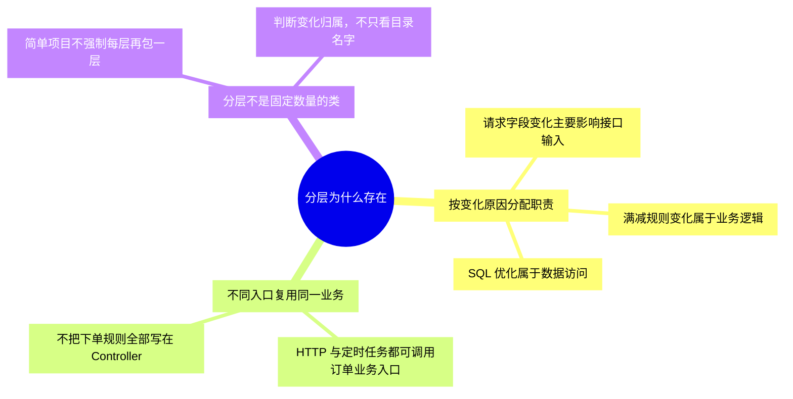
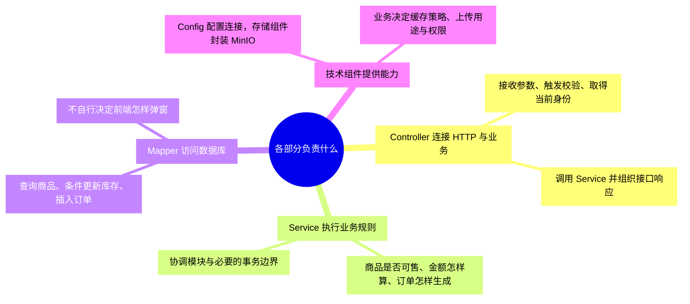
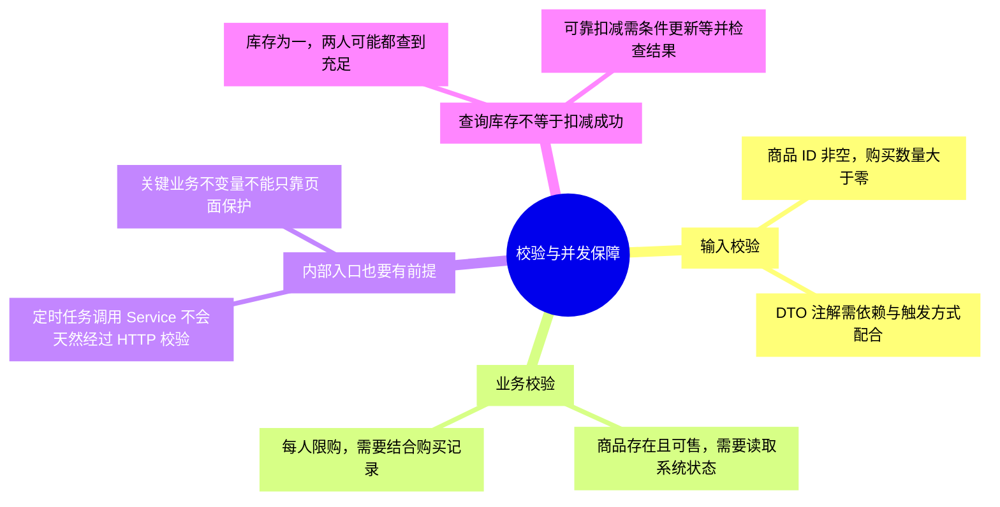
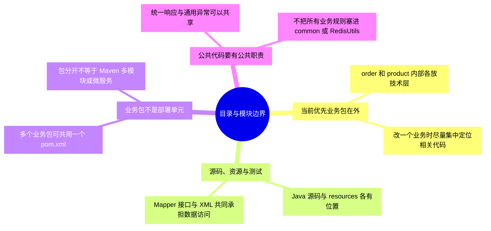
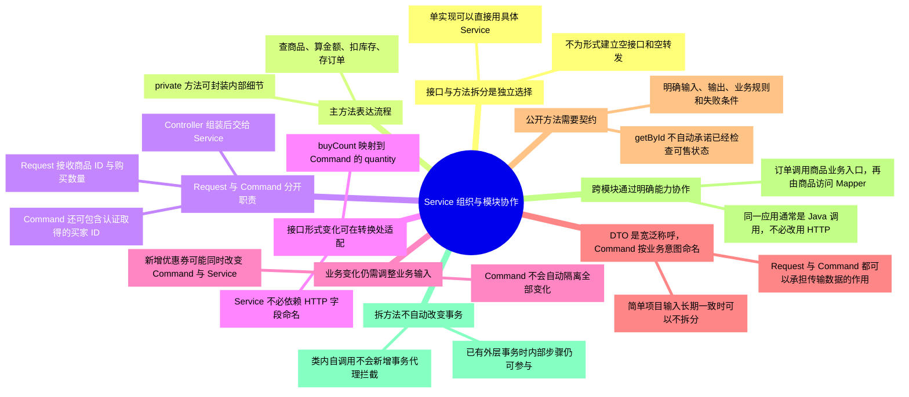
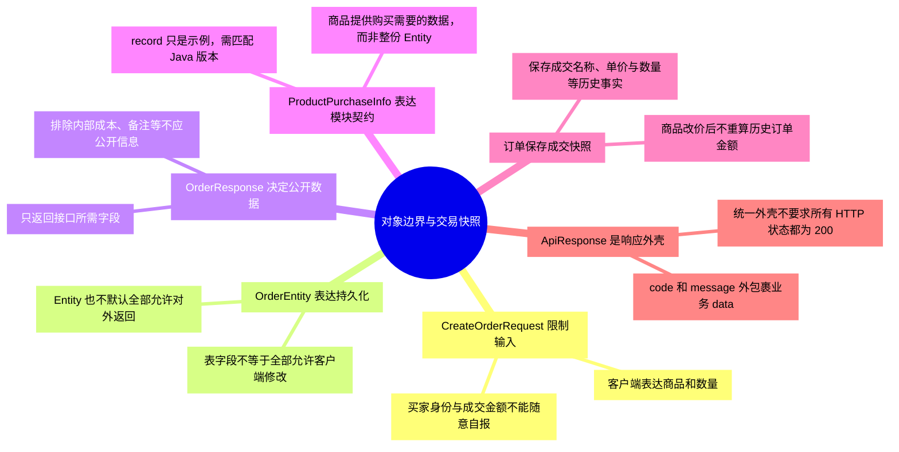
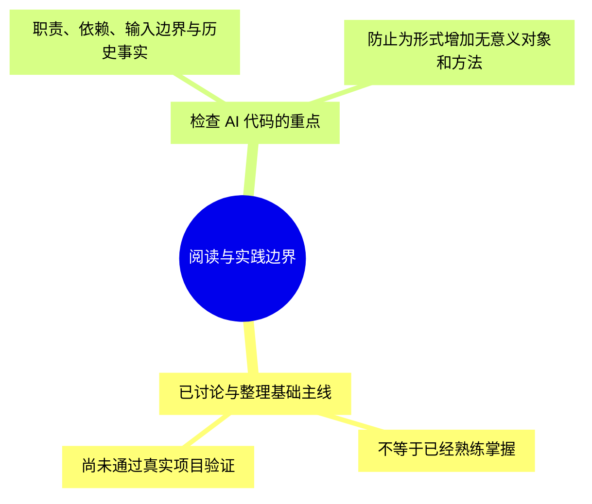

# 第一章-项目结构与职责：详细导图

正文入口：[[00-第一章-项目结构与职责]]。本轮细化为 **106 个节点、四级结构**，包含核心概念、具体判断或流程、例子与常见误区。

## 怎样使用

- 原生 XMind 保存整章详细树，可按主题展开、折叠和缩放；需要回看时用节点关键词定位正文。
- 下方按主题拆成多张 Mermaid 分图，避免在 Obsidian 把整章挤成一张无法阅读的大图。
- 导图是回忆与定位材料，正文保留适用条件和更完整示例。节点出现不代表已经讨论、掌握或通过实践。

原生文件：[[第一章-项目结构与职责.xmind|第一章-项目结构与职责 XMind 思维导图]]。

Markdown 源稿：[[第一章-项目结构与职责-XMind导入大纲]]。

阅读顺序：[[01-分层职责与校验]] → [[02-目录结构与基础设施]] → [[03-Service组织与模块协作]] → [[04-数据对象与交易快照]]。

## 1. 分层为什么存在

## 2. 各部分负责什么

## 3. 校验与并发保障

## 4. 目录与模块边界

## 5. Service 组织与模块协作

## 6. 对象边界与交易快照

## 7. 阅读与实践边界

## 状态

原生文件的保存、展开显示和结构核对结果见 [[学习进度与交接]]。Mermaid 尚未在 Obsidian 界面逐图验证；源稿与原生文件应随正文同步维护。
