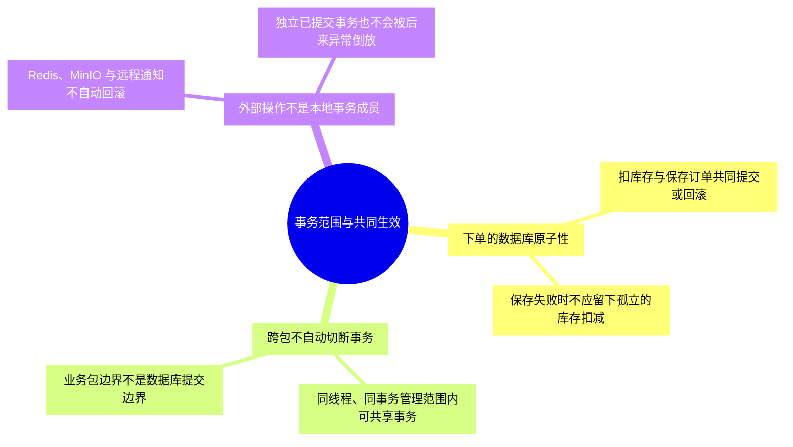
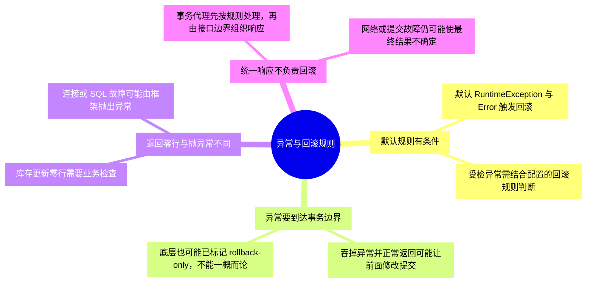
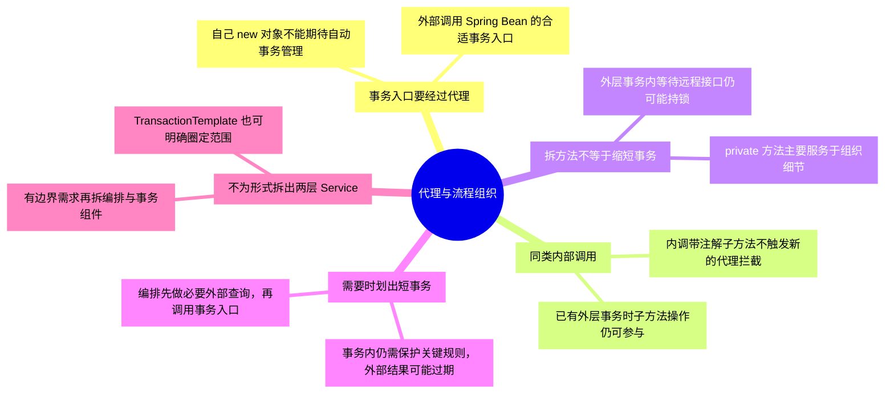
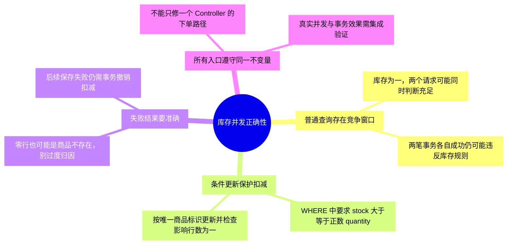
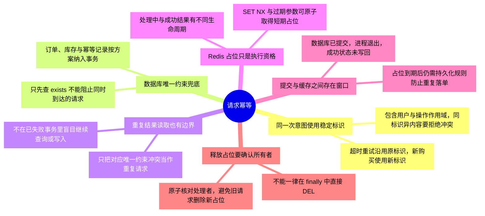
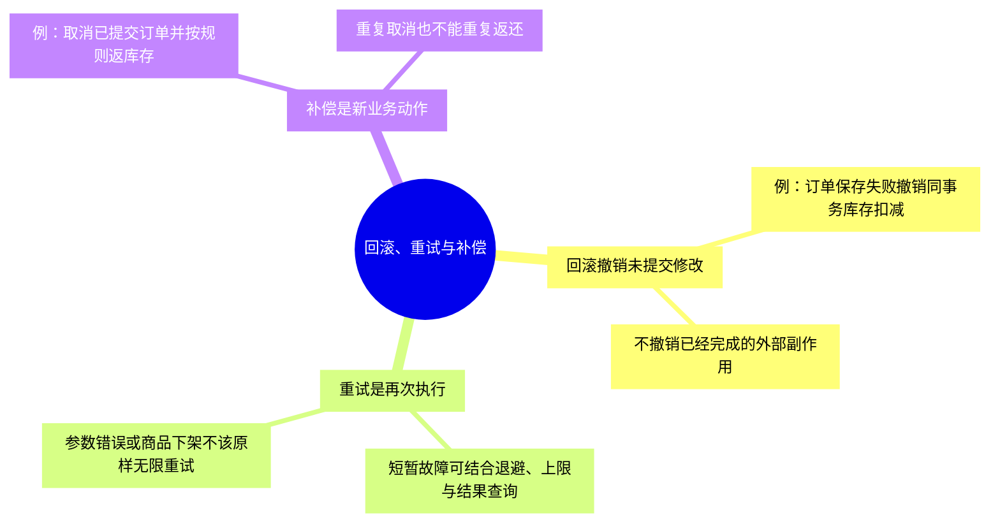
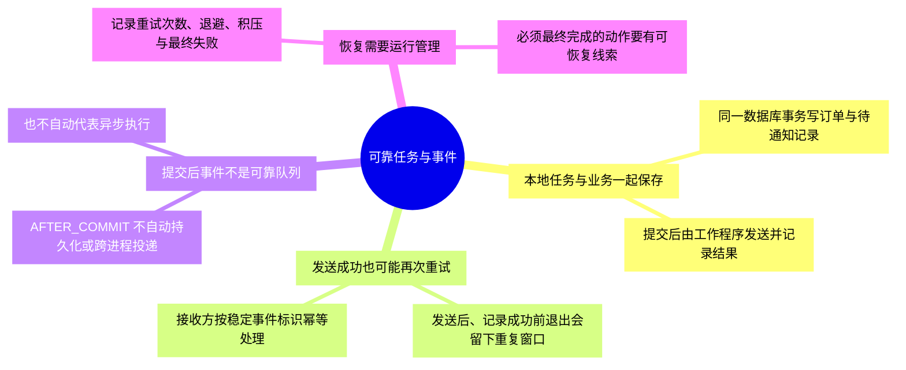
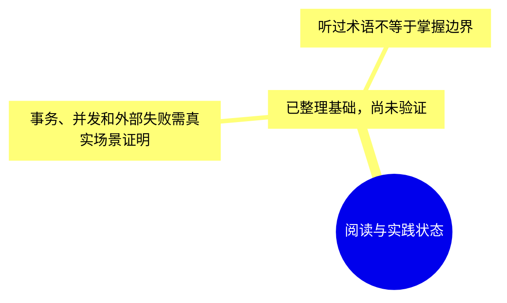

# 第三章-业务逻辑与事务：详细导图

正文入口：[[00-第三章-业务逻辑与事务]]。本轮细化为 **99 个节点、四级结构**，包含核心概念、具体判断或流程、例子与常见误区。

## 怎样使用

- 原生 XMind 保存整章详细树，可按主题展开、折叠和缩放；需要回看时用节点关键词定位正文。
- 下方按主题拆成多张 Mermaid 分图，避免在 Obsidian 把整章挤成一张无法阅读的大图。
- 导图是回忆与定位材料，正文保留适用条件和更完整示例。节点出现不代表已经讨论、掌握或通过实践。

原生文件：[[第三章-业务逻辑与事务.xmind|第三章-业务逻辑与事务 XMind 思维导图]]。

Markdown 源稿：[[第三章-业务逻辑与事务-XMind导入大纲]]。

阅读顺序：[[01-事务边界与异常回滚]] → [[02-事务代理与业务流程组织]] → [[03-库存并发与请求幂等]] → [[04-失败恢复与可靠任务]]。

## 1. 事务范围与共同生效

## 2. 异常与回滚规则

## 3. 代理与流程组织

## 4. 库存并发正确性

## 5. 请求幂等

## 6. 回滚、重试与补偿

## 7. 可靠任务与事件

## 8. 阅读与实践状态

## 状态

原生文件的保存、展开显示和结构核对结果见 [[学习进度与交接]]。Mermaid 尚未在 Obsidian 界面逐图验证；源稿与原生文件应随正文同步维护。
