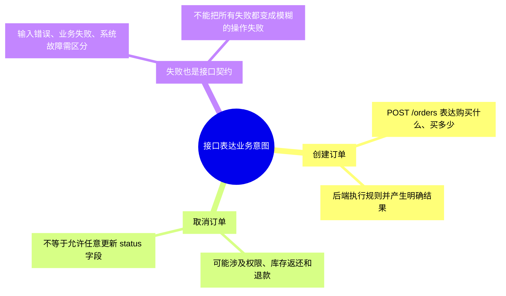
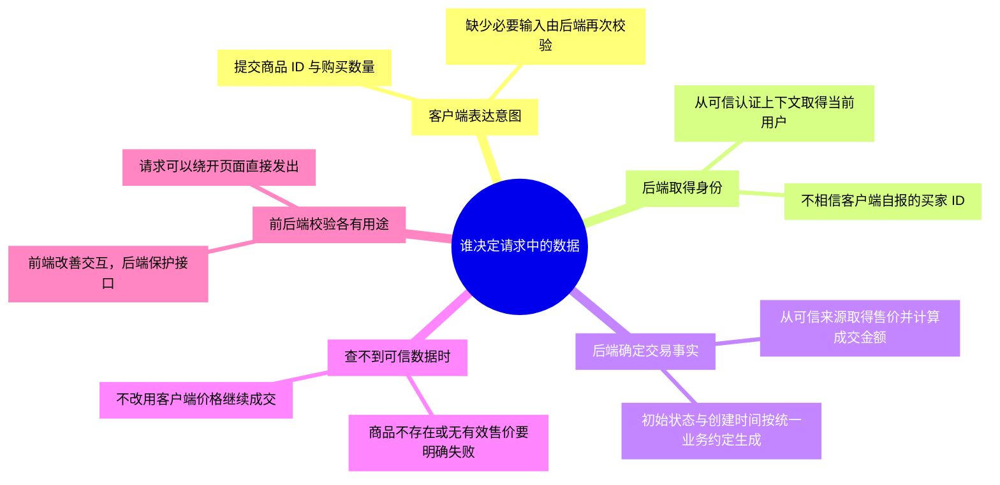
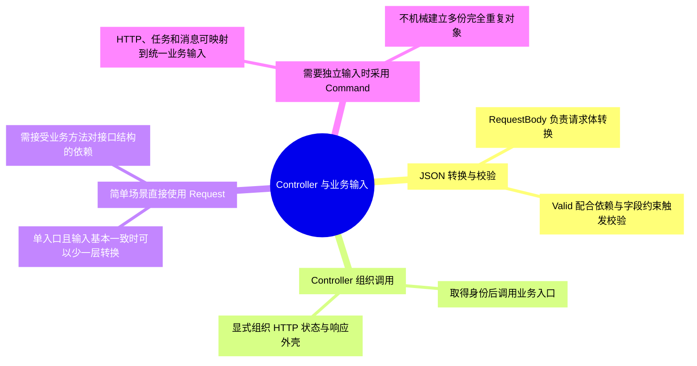
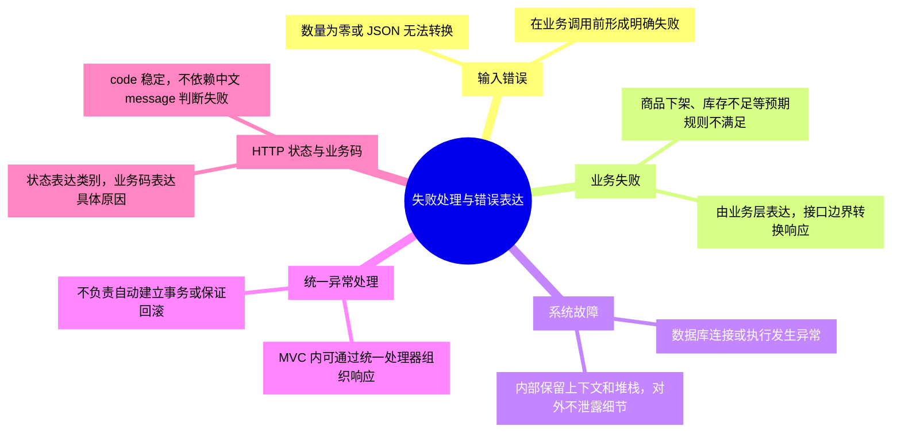
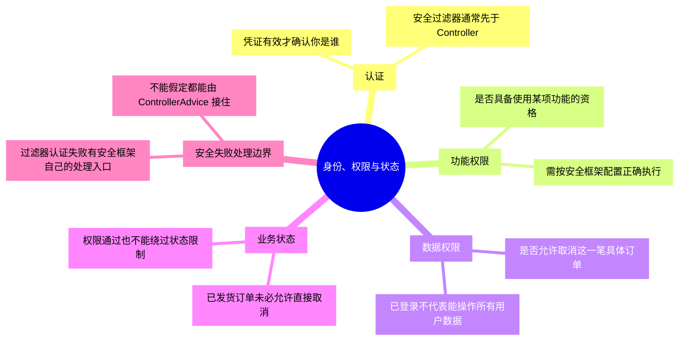
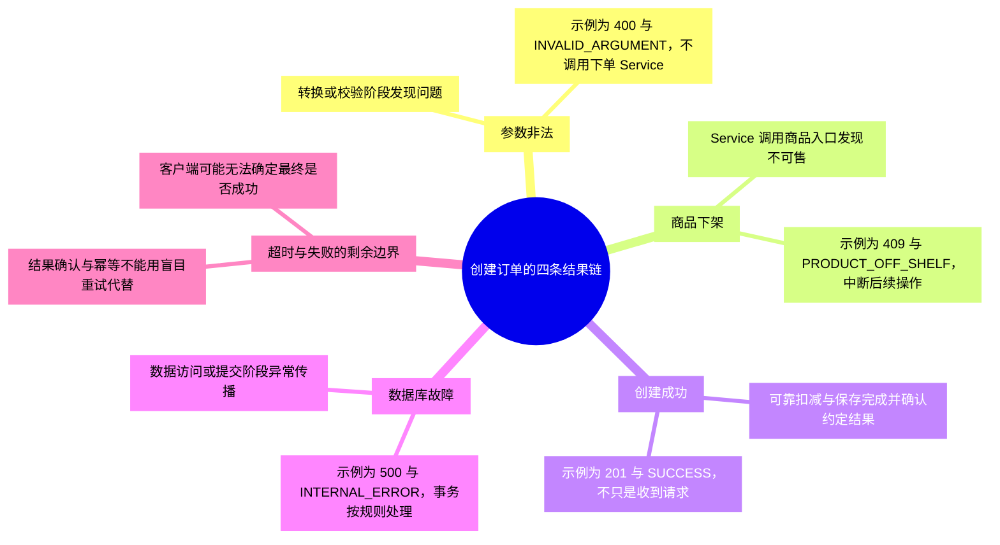
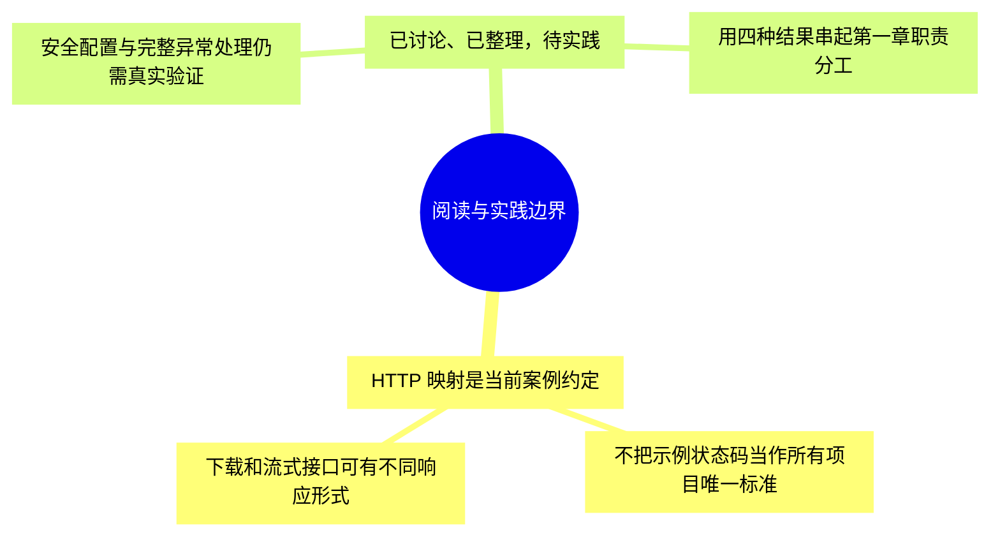

# 第二章-接口设计与数据流转：详细导图

正文入口：[[00-第二章-接口设计与数据流转]]。本轮细化为 **95 个节点、四级结构**，包含核心概念、具体判断或流程、例子与常见误区。

## 怎样使用

- 原生 XMind 保存整章详细树，可按主题展开、折叠和缩放；需要回看时用节点关键词定位正文。
- 下方按主题拆成多张 Mermaid 分图，避免在 Obsidian 把整章挤成一张无法阅读的大图。
- 导图是回忆与定位材料，正文保留适用条件和更完整示例。节点出现不代表已经讨论、掌握或通过实践。

原生文件：[[第二章-接口设计与数据流转.xmind|第二章-接口设计与数据流转 XMind 思维导图]]。

Markdown 源稿：[[第二章-接口设计与数据流转-XMind导入大纲]]。

阅读顺序：[[00-第二章-接口设计与数据流转]] → [[创建订单-四种结果与调用链]]。

## 1. 接口表达业务意图

## 2. 谁决定请求中的数据

## 3. Controller 与业务输入

## 4. 失败处理与错误表达

## 5. 身份、权限与状态

## 6. 创建订单的四条结果链

## 7. 阅读与实践边界

## 状态

原生文件的保存、展开显示和结构核对结果见 [[学习进度与交接]]。Mermaid 尚未在 Obsidian 界面逐图验证；源稿与原生文件应随正文同步维护。
