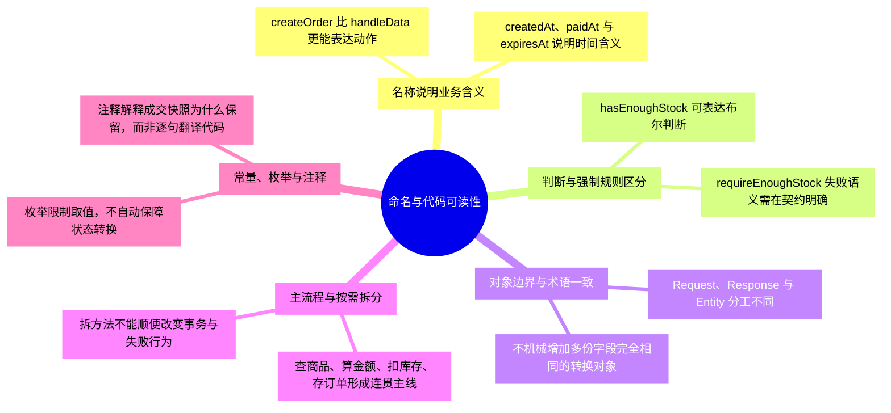
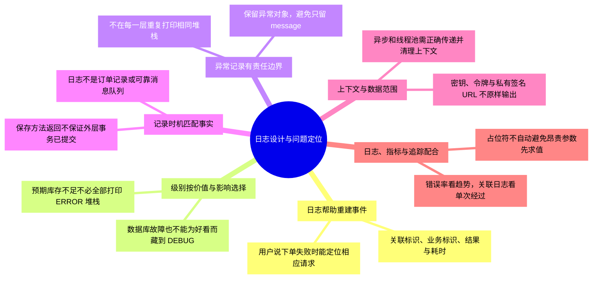
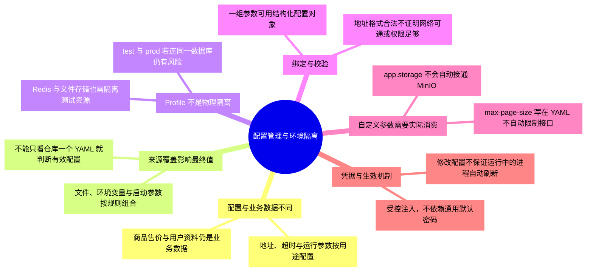
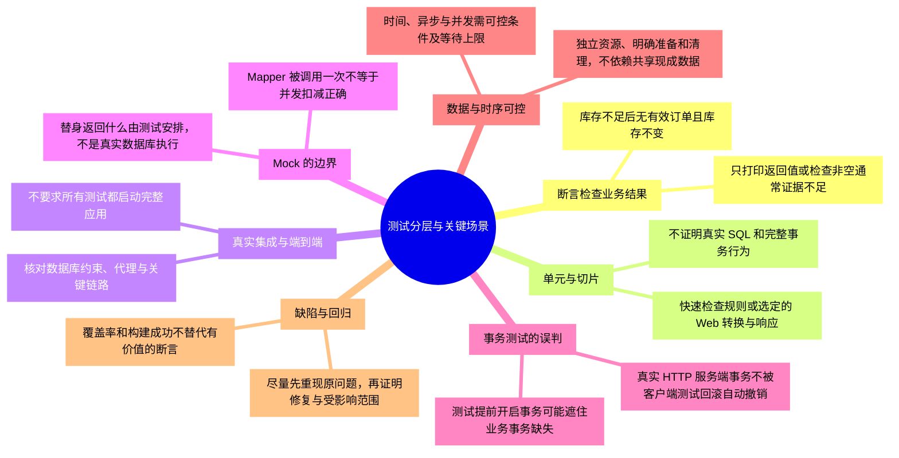
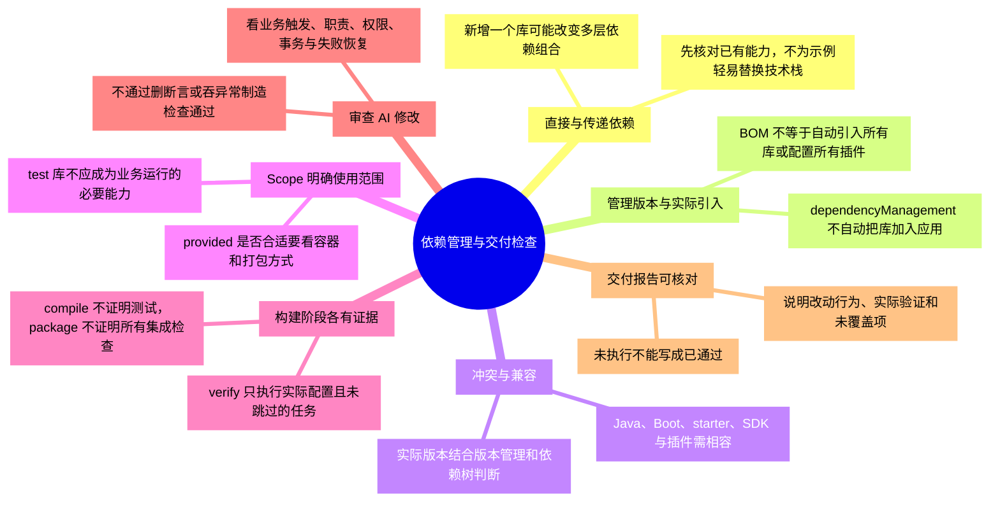
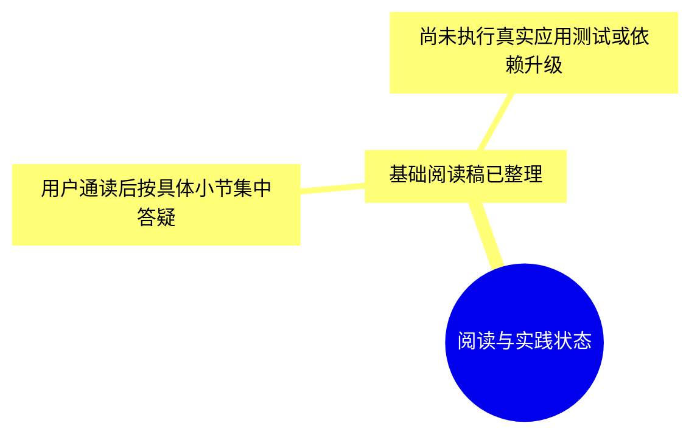

# 第五章-工程规范与质量：详细导图

正文入口：[[00-第五章-工程规范与质量]]。本轮细化为 **103 个节点、四级结构**，包含核心概念、具体判断或流程、例子与常见误区。

## 怎样使用

- 原生 XMind 保存整章详细树，可按主题展开、折叠和缩放；需要回看时用节点关键词定位正文。
- 下方按主题拆成多张 Mermaid 分图，避免在 Obsidian 把整章挤成一张无法阅读的大图。
- 导图是回忆与定位材料，正文保留适用条件和更完整示例。节点出现不代表已经讨论、掌握或通过实践。

原生文件：[[第五章-工程规范与质量.xmind|第五章-工程规范与质量 XMind 思维导图]]。

Markdown 源稿：[[第五章-工程规范与质量-XMind导入大纲]]。

阅读顺序：[[01-命名与代码可读性]] → [[02-日志设计与问题定位]] → [[03-配置管理与环境隔离]] → [[04-测试分层与关键场景]] → [[05-依赖管理与交付检查]]。

## 1. 命名与代码可读性

## 2. 日志设计与问题定位

## 3. 配置管理与环境隔离

## 4. 测试分层与关键场景

## 5. 依赖管理与交付检查

## 6. 阅读与实践状态

## 状态

原生文件的保存、展开显示和结构核对结果见 [[学习进度与交接]]。Mermaid 尚未在 Obsidian 界面逐图验证；源稿与原生文件应随正文同步维护。
