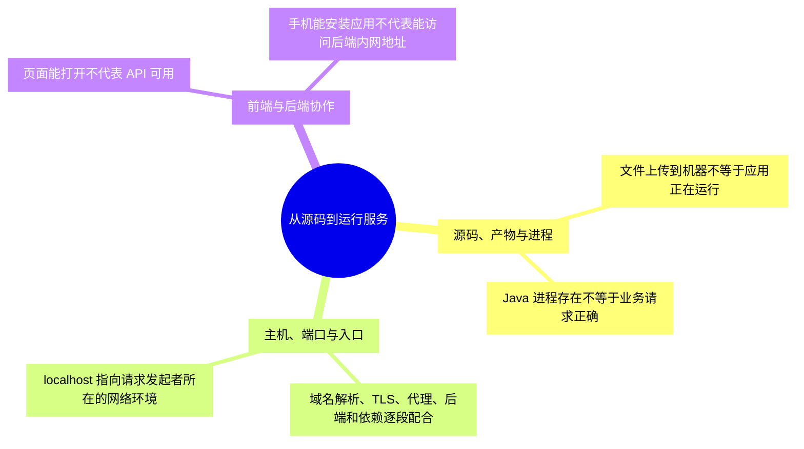
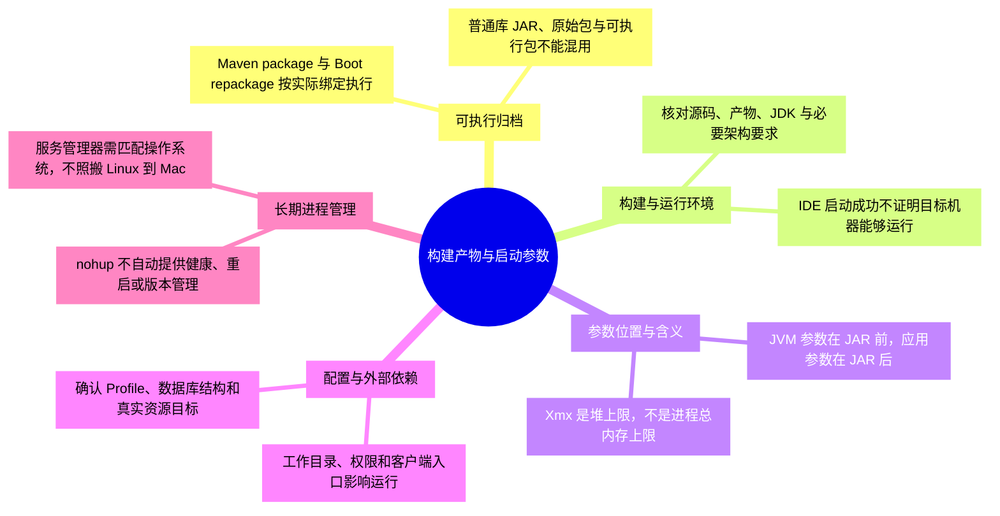
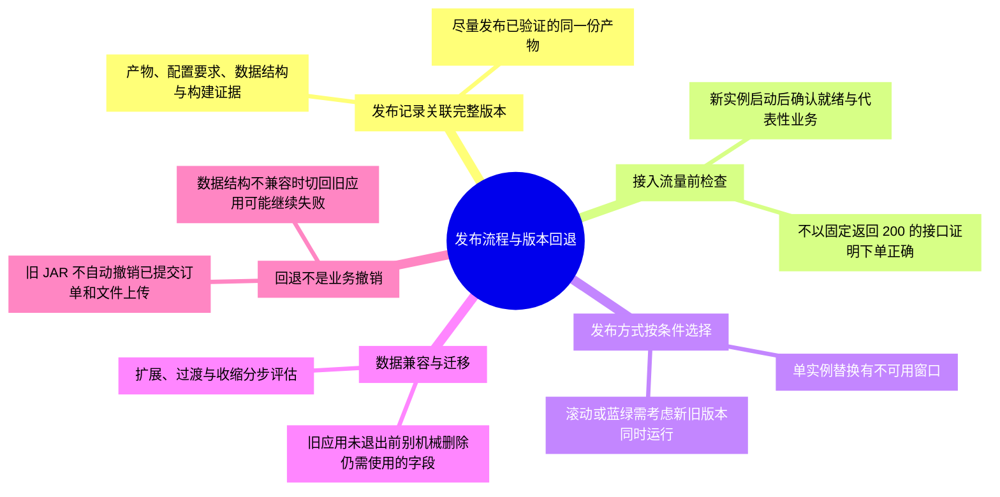
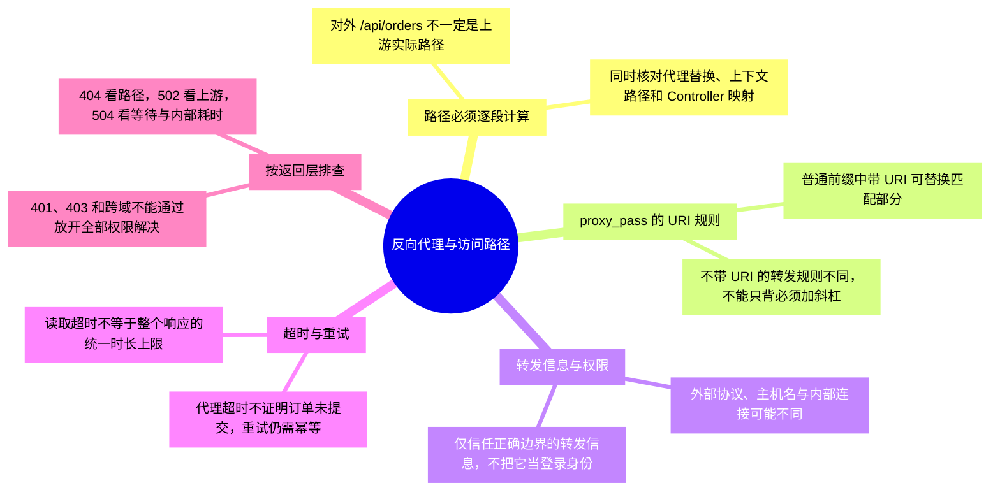
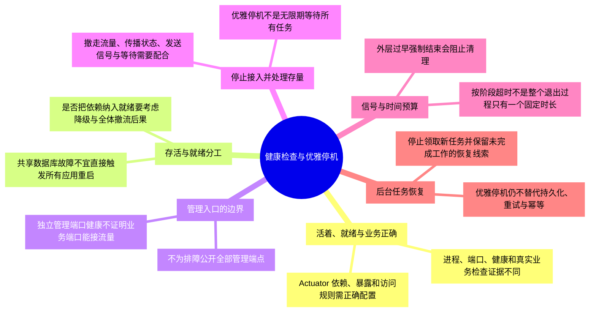
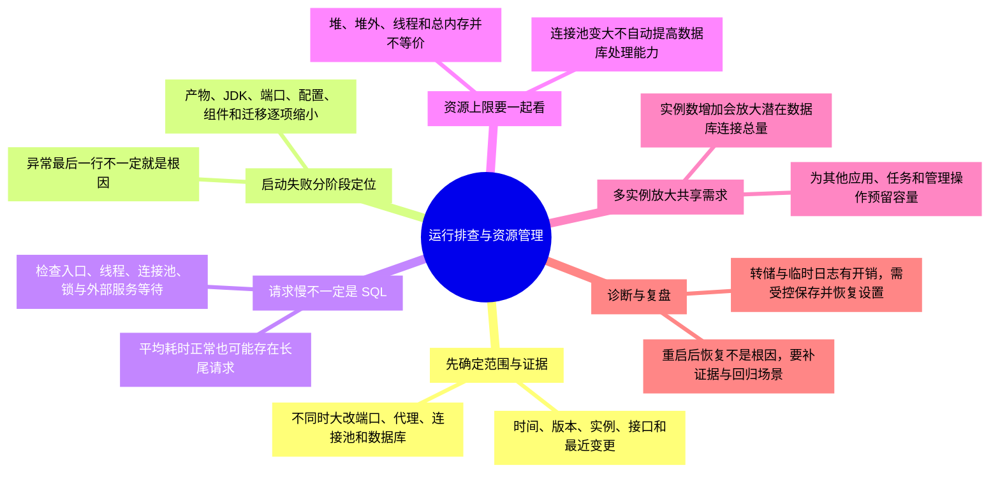
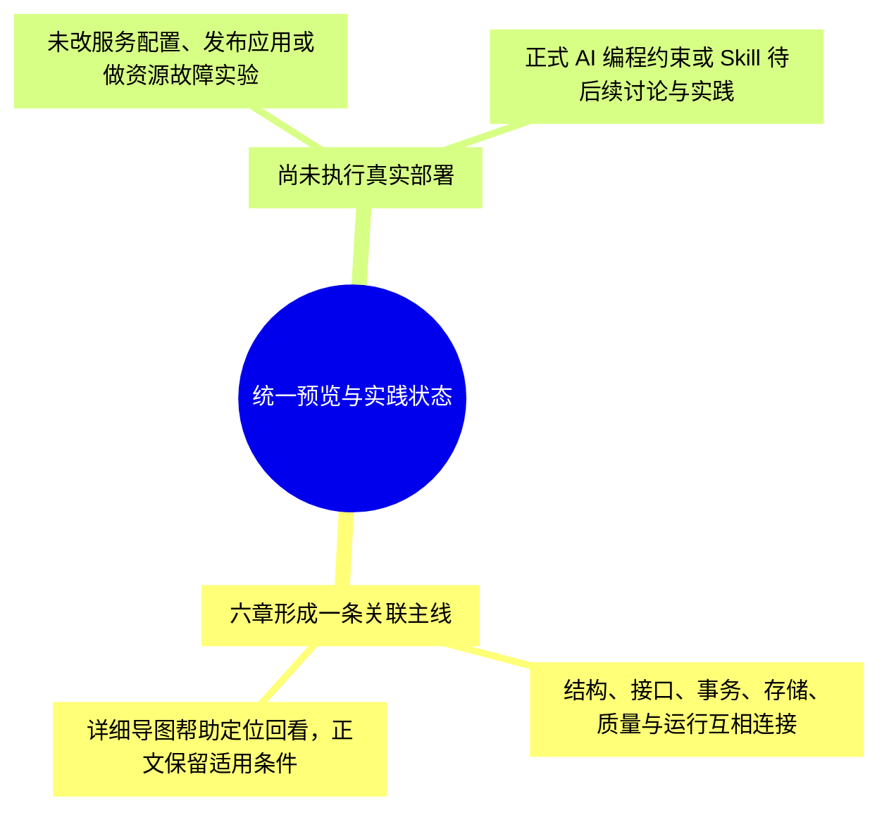

# 第六章-部署与运行：详细导图

正文入口：[[00-第六章-部署与运行]]。本轮细化为 **104 个节点、四级结构**，包含核心概念、具体判断或流程、例子与常见误区。

## 怎样使用

- 原生 XMind 保存整章详细树，可按主题展开、折叠和缩放；需要回看时用节点关键词定位正文。
- 下方按主题拆成多张 Mermaid 分图，避免在 Obsidian 把整章挤成一张无法阅读的大图。
- 导图是回忆与定位材料，正文保留适用条件和更完整示例。节点出现不代表已经讨论、掌握或通过实践。

原生文件：[[第六章-部署与运行.xmind|第六章-部署与运行 XMind 思维导图]]。

Markdown 源稿：[[第六章-部署与运行-XMind导入大纲]]。

阅读顺序：[[部署基础与请求链路]] → [[01-构建产物与启动参数]] → [[02-发布流程与版本回退]] → [[03-反向代理与访问路径]] → [[04-健康检查与优雅停机]] → [[05-运行排查与资源管理]]。

## 1. 从源码到运行服务

## 2. 构建产物与启动参数

## 3. 发布流程与版本回退

## 4. 反向代理与访问路径

## 5. 健康检查与优雅停机

## 6. 运行排查与资源管理

## 7. 统一预览与实践状态

## 状态

原生文件的保存、展开显示和结构核对结果见 [[学习进度与交接]]。Mermaid 尚未在 Obsidian 界面逐图验证；源稿与原生文件应随正文同步维护。
