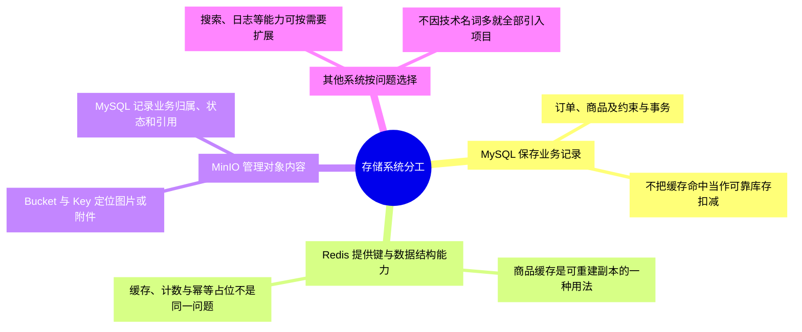
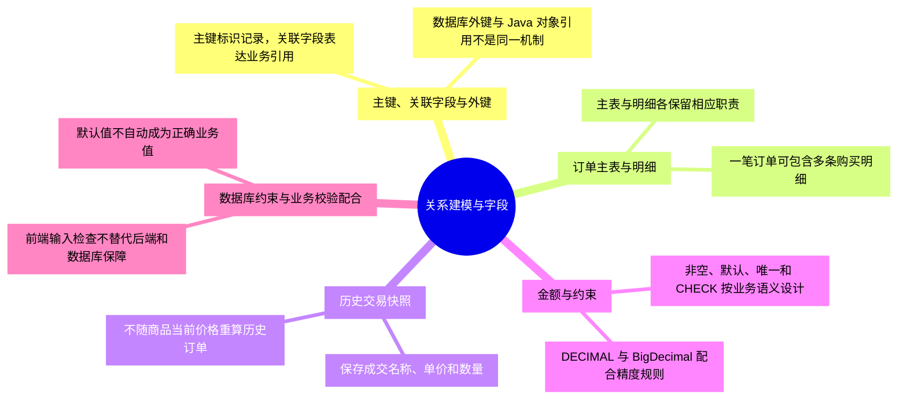
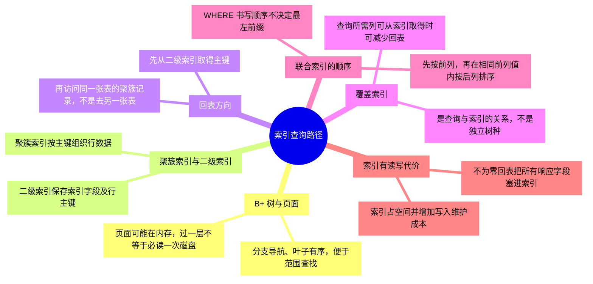
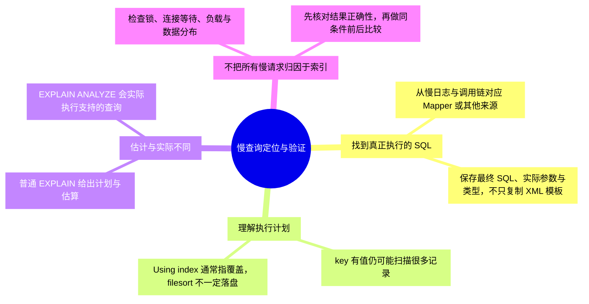
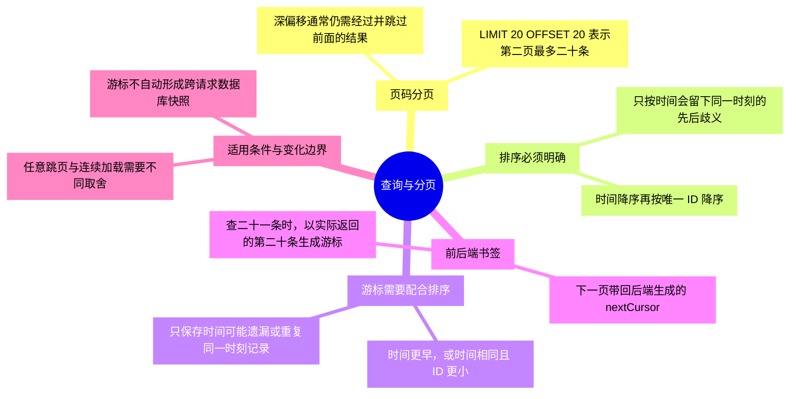
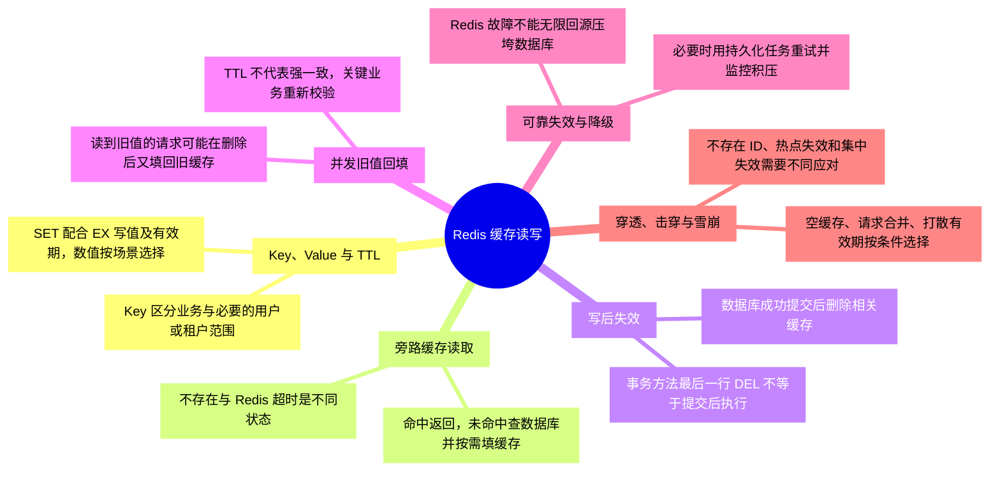
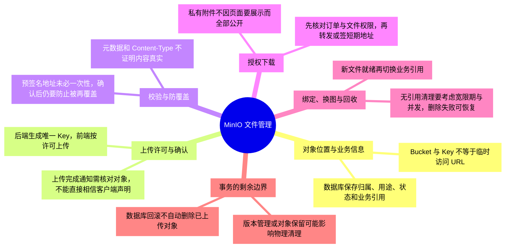
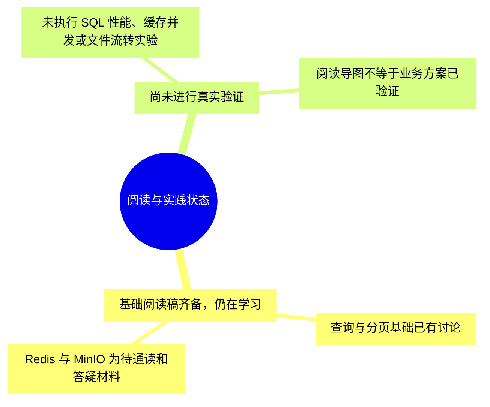

# 第四章-数据存储与访问：详细导图

正文入口：[[00-第四章-数据存储与访问]]。本轮细化为 **123 个节点、四级结构**，包含核心概念、具体判断或流程、例子与常见误区。

## 怎样使用

- 原生 XMind 保存整章详细树，可按主题展开、折叠和缩放；需要回看时用节点关键词定位正文。
- 下方按主题拆成多张 Mermaid 分图，避免在 Obsidian 把整章挤成一张无法阅读的大图。
- 导图是回忆与定位材料，正文保留适用条件和更完整示例。节点出现不代表已经讨论、掌握或通过实践。

原生文件：[[第四章-数据存储与访问.xmind|第四章-数据存储与访问 XMind 思维导图]]。

Markdown 源稿：[[第四章-数据存储与访问-XMind导入大纲]]。

阅读顺序：[[01-存储系统分工与扩展选型]] → [[02-关系建模与订单明细]] → [[03-字段类型与数据约束]] → [[04-B加树与索引查询路径]] → [[05-慢查询定位与优化验证]] → [[06-查询设计与分页]] → [[07-Redis缓存读写与一致性]] → [[08-MinIO文件与业务记录管理]]。

## 1. 存储系统分工

## 2. 关系建模与字段

## 3. 索引查询路径

## 4. 慢查询定位与验证

## 5. 查询与分页

## 6. Redis 缓存读写

## 7. MinIO 文件管理

## 8. 阅读与实践状态

## 状态

原生文件的保存、展开显示和结构核对结果见 [[学习进度与交接]]。Mermaid 尚未在 Obsidian 界面逐图验证；源稿与原生文件应随正文同步维护。
