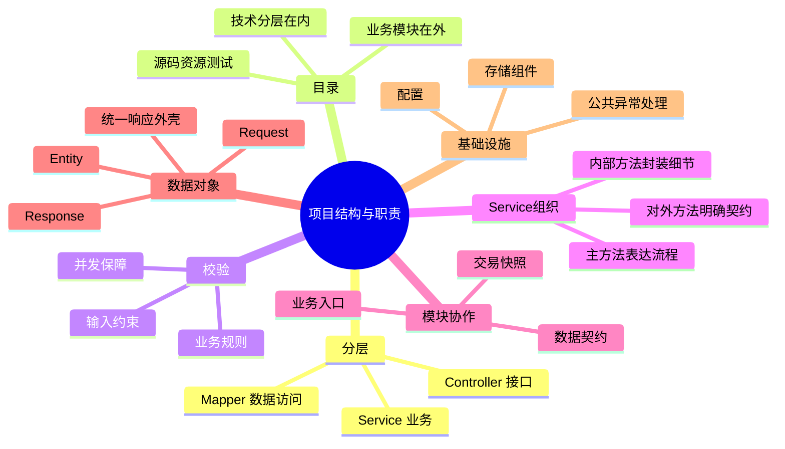

# 第一章导图与大纲

对应正文：[[00-第一章-项目结构与职责|第一章-项目结构与职责]]。

## Obsidian 总览

## XMind 使用

配套文件：[[第一章-项目结构与职责-XMind导入大纲]]。

这是标准 Markdown 标题层级大纲，不是原生 .xmind 文件。可在支持 Markdown 导入的 XMind 版本中选择该文件，导入后另存为 .xmind。当前未在本地 XMind 实际导入验证；具体菜单以安装版本为准。正文是详细知识来源，导图用于回忆结构。
