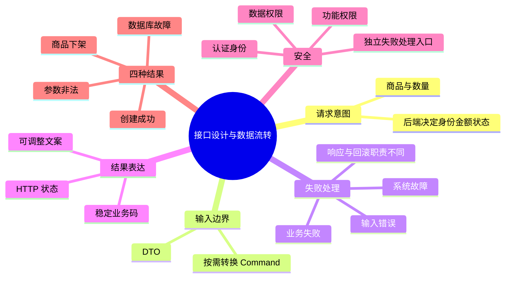

# 第二章导图与大纲

正文：[[00-第二章-接口设计与数据流转|第二章-接口设计与数据流转]] · 案例：[[创建订单-四种结果与调用链]]。

XMind 大纲：[[第二章-接口设计与数据流转-XMind导入大纲]]。它是 Markdown 标题层级文件，不是原生 .xmind；可在支持 Markdown 导入的 XMind 版本中导入后另存。尚未在本地 XMind 验证。Mermaid 也未通过应用界面进行视觉验证。
